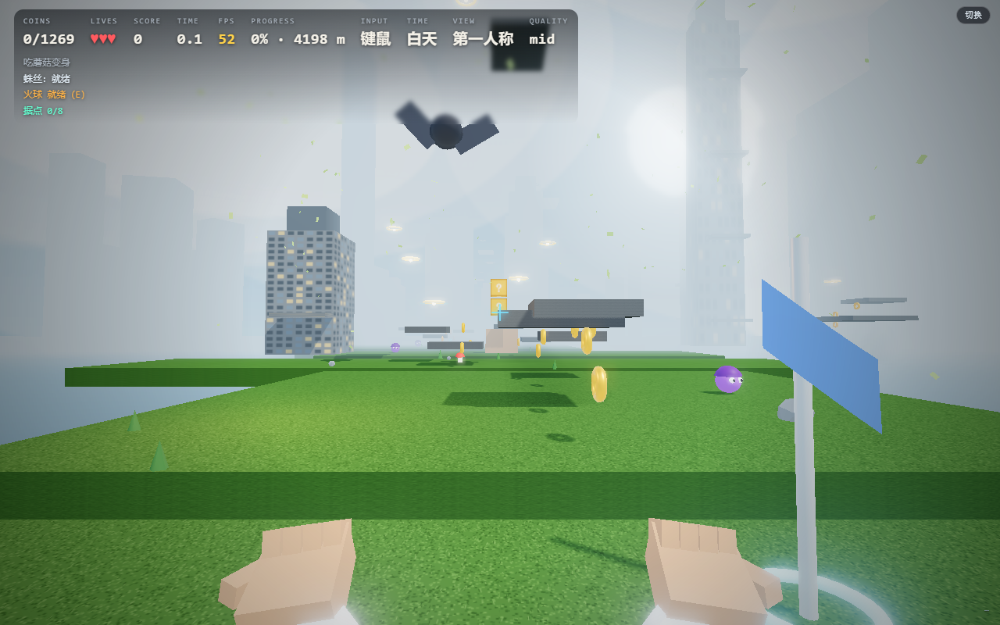
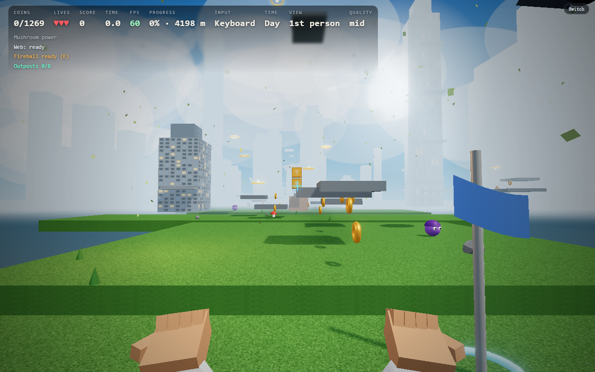

# 🕷️ PLUMB 3D — a 4.2 km skyline parkour game in one index.html

> **Click once and the web yanks you into the air. Fireballs shatter walls. Bridges collapse plank by plank under your feet.**
> Zero external assets, zero build requirement, single-file 3D game that runs straight from `file://`. Same game on a phone in landscape.

  

## 🚀 Run it

1. Download `dist/index.html` and open it — that is the whole game.
2. Phone: serve the folder and open `dist/index.html` in landscape (big web button + ring of skills).
3. From source: `npm i -D esbuild three` then `node tools/build.mjs` / `node tools/build-packed.mjs`.

## 🌐 Language

The HUD, title card, pause / game-over / clear screens and every toast are bilingual. It follows the browser locale (`zh-*` → Chinese, otherwise English), remembers the choice in `localStorage`, and **`L`** toggles it in game. Force it with `?lang=zh` or `?lang=en`.

## ⌨️ Controls

`WASD` move · `Shift` sprint · `Space` triple jump · **LMB / Q** web · `E` fireball · `C` shockwave · `Esc` pause · `V` view · `N` time of day · `L` language.

## 🧩 Highlights

- Web: hit-to-fly impulse, hard winch for 0.45 s, re-fire replaces the old web on the same frame, wall slide that climbs the anchor
- Instanced city in 300 m chunks so frustum culling still works (52 FPS mid tier)
- Verlet cloth flags, verlet rope, water waves, breakable walls, collapsing bridges, giant birds you can grapple
- Deterministic self-test: open `?selftest=1` for 25 probes printed as JSON

## 📦 Size

`dist/index.html` 244.8 KB raw (gzip + base64 + `DecompressionStream`), `dist/index-plain.html` 666.1 KB readable fallback.

## 📄 License

MIT © mengbot. Every mesh, texture and sound is generated in code at runtime.
