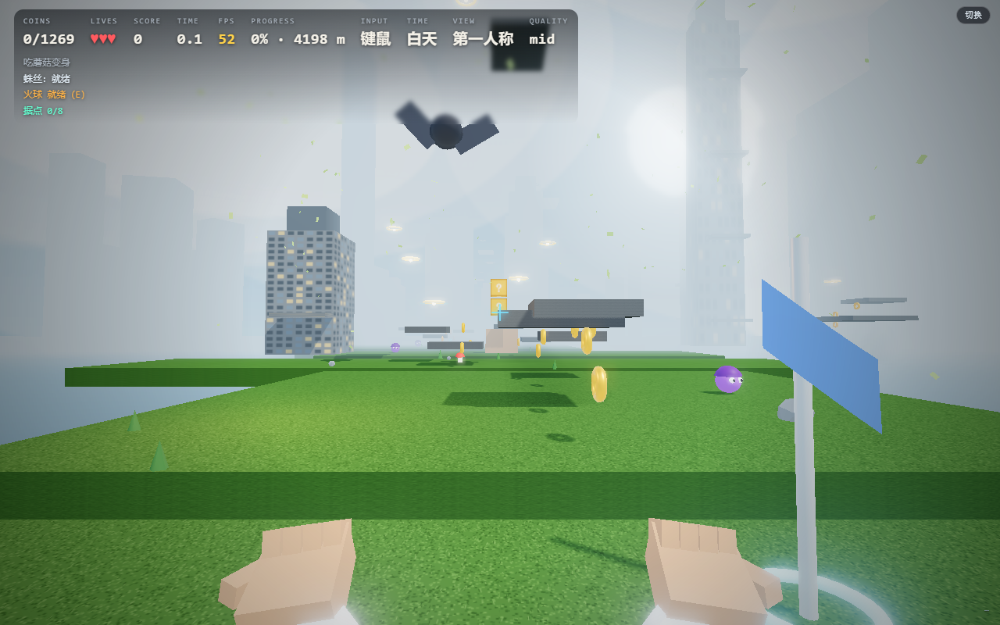
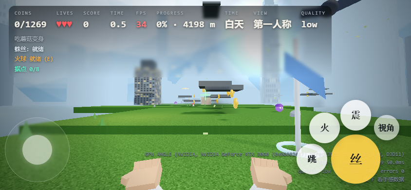
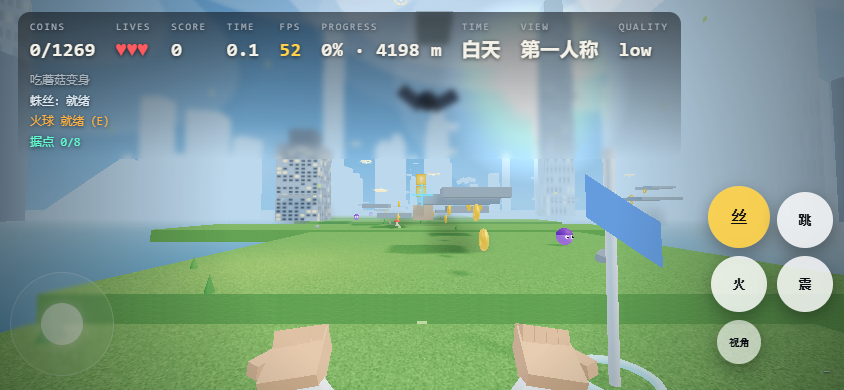
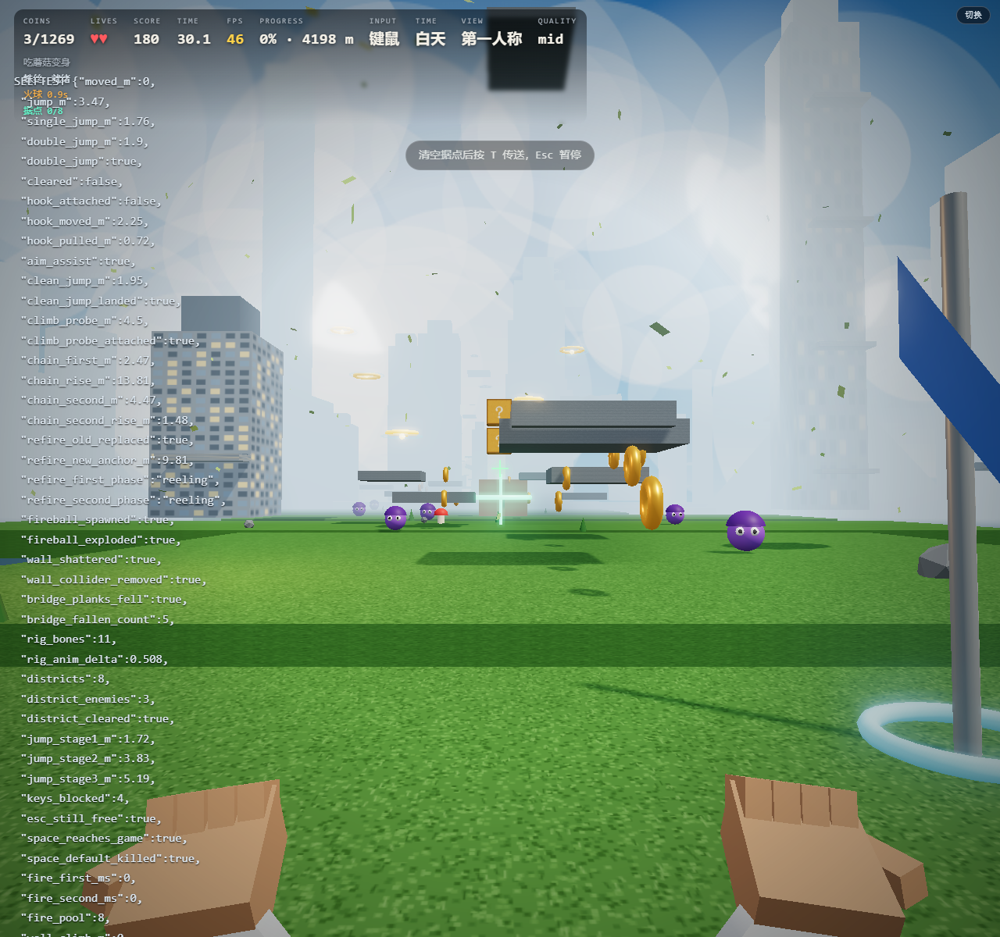

# 🕷️ PLUMB 3D — 一个 index.html 的 4.2 公里浮空城市跑酷

> **点一下蛛丝就飞出去，火球炸碎墙，木桥在你脚下逐块塌落。**
> 零外部资源、零构建依赖、双击即玩的单文件 3D 游戏；手机横屏同款操作。

<p align="center">
  
  
  
  
  <a href="LICENSE"></a>
</p>

<p align="center"><strong>⭐ 觉得能玩就点个 Star</strong>，也欢迎直接提 Issue 说手感哪里不对</p>

<p align="center">
  
</p>

---

## 🚀 三步开始

<details open>
<summary><b>① 直接玩（不需要装任何东西）</b></summary>

下载 `dist/index.html` → 双击打开。就是完整的游戏。

</details>

<details>
<summary><b>② 手机玩（同一个 WiFi）</b></summary>

```bash
# 电脑上起一个静态服务
python -m http.server 8788 --bind 0.0.0.0
# 手机浏览器打开（电脑局域网 IP）
http://192.168.x.x:8788/dist/index.html
```

横屏游玩：左下是大摇杆，右下是**大蛛丝键 + 环形技能键**。

</details>

<details>
<summary><b>③ 从源码构建</b></summary>

```bash
npm i -D esbuild three
node tools/build.mjs          # → dist/index-plain.html（未压缩，可审计）
node tools/build-packed.mjs   # → dist/index.html（gzip 自解压，244.8 KB）
```

`tools/entry-trim.js` 是按名导入 three 的入口，只打进实际用到的 45 个类。

</details>

---

## 🎮 你在玩什么

| | |
|---|---|
| **关卡** | 4200 m 浮空城市 · 35 检查点 · 1269 枚金币 · 172 座 18–60 m 高楼 · 506 个蛛丝跳点 · 8 个可占领据点 |
| **核心动作** | 蛛丝命中即飞（26–58 m/s）· 收线中再点**同帧换目标** · 撞墙贴墙滑行并沿墙爬升 · 三级跳（1.72 / 3.83 / 5.19 m） |
| **战斗** | 火球（4.6 m 爆炸）· 震波（需蘑菇变身）· 踩踏 · 巨鸟俯冲（可被蛛丝粘住拖着飞） |
| **可破坏** | 火球炸碎墙、踩上木桥后逐块塌落 |
| **目标** | 跑到终点旗，压缩通关时间；最佳纪录存在浏览器本地 |

<p align="center">
  
</p>

## 📸 截图

| 手机端 | 桌面端 |
|---|---|
|  |  |

<details>
<summary>自检输出（25 条确定性探针）</summary>



</details>

## ⌨️ 操作

| 动作 | PC | 手机 |
|---|---|---|
| 移动 / 冲刺 | `WASD` / `Shift` | 左摇杆（推满冲刺） |
| 跳（三级） | `Space` | 「跳」 |
| **吐蛛丝** | **左键 / `Q`** | 大「丝」键 |
| 火球 | `E` | 「火」 |
| 震波 | `C` / 右键 | 「震」 |
| 视角 | 鼠标（指针锁；被拒时右键拖拽） | 右半屏拖动 |
| 暂停 | `Esc` | — |
| 其它 | `V` 视角 · `N` 时间 · `B` 辉光 · `G` 环境遮蔽 · `T` 传送据点 · `R` 回检查点 · `[` `]` 灵敏度 · `I` 反转 Y · `M` 音乐 | 「视角」 |

---

## 🧩 技术要点

| 系统 | 实现 |
|---|---|
| 渲染 | three.js r171（内联，无 CDN）· ACES 色调映射 · 动态分辨率 0.72–1.0 |
| 性能 | 楼体 / 地面 / 平台**按 300 m 分块实例化**（保住视锥剔除）· Lambert 材质 · 移动端预算 |
| 物理 | 蛛丝 16 点 verlet 绳 · 旗帜布料 verlet + 玩家胶囊排斥 · 刚体碎片 · 水面波浪 |
| 玩法 | 单摆约束 + 硬绞盘收线 · 锥形瞄准辅助 · 瓦片碰撞 + 逐轴解算 + 去穿透 |
| 画面 | Bloom · high 档 SSAO · 体积云 · 远山 · 接触阴影 · 白天/黄昏/夜晚三套光照 |
| 音效 | WebAudio 程序化合成 · calm/danger/buff 三层动态音乐 |
| 设备适配 | 自动识别 PC / 触控两套方案 · PC 沉浸模式（隐藏光标、拦截浏览器快捷键、全屏） |

## 🧪 自检

打开 `dist/index.html?selftest=1`，会在 300 米高空的无干扰测试台上跑确定性探针并打印 JSON：

```json
{
  "aim_assist": true, "clean_jump_m": 1.95, "climb_probe_m": 4.5,
  "chain_first_m": 2.47, "chain_second_m": 4.47,
  "refire_old_replaced": true, "refire_new_anchor_m": 9.81,
  "fireball_spawned": true, "wall_shattered": true, "bridge_fallen_count": 5,
  "jump_stage1_m": 1.72, "jump_stage2_m": 3.83, "jump_stage3_m": 5.19,
  "districts": 8, "district_cleared": true,
  "keys_blocked": 4, "space_reaches_game": true,
  "towers": 172, "web_nodes": 506, "level_len_m": 4200, "errors": 0
}
```

<p align="center">
  
</p>

## 📦 体积

| 文件 | raw | brotli | 说明 |
|---|---|---|---|
| `dist/index.html` | **244.8 KB** | 176.2 KB | gzip 自解压单文件（Chrome 80+ / Safari 16.4+ / Firefox 113+） |
| `dist/index-plain.html` | 666.1 KB | 146.3 KB | 未压缩版，老浏览器兜底与源码审计对象 |

压缩三步：`game.js` esbuild --minify（172.9 → 101.8 KB）→ three 按名导入 tree-shake（706.8 → 550.5 KB）→ gzip + base64 + `DecompressionStream` 运行时自解压。

## 🗺️ 路线图

- [ ] 角色骨骼动画（现在是 11 骨程序化姿态）
- [ ] 布料与地形碰撞
- [ ] 关卡编辑器 / 自定义关卡 JSON
- [ ] 排行榜（需要后端）

## 📄 License

[MIT](LICENSE) · 全部几何、贴图、音效均在运行时用代码生成，无第三方素材。
